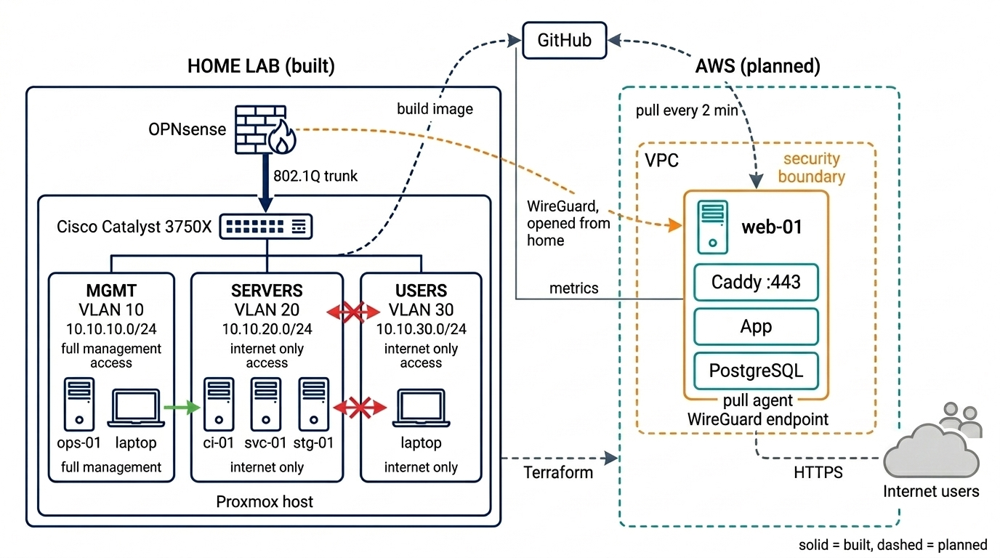
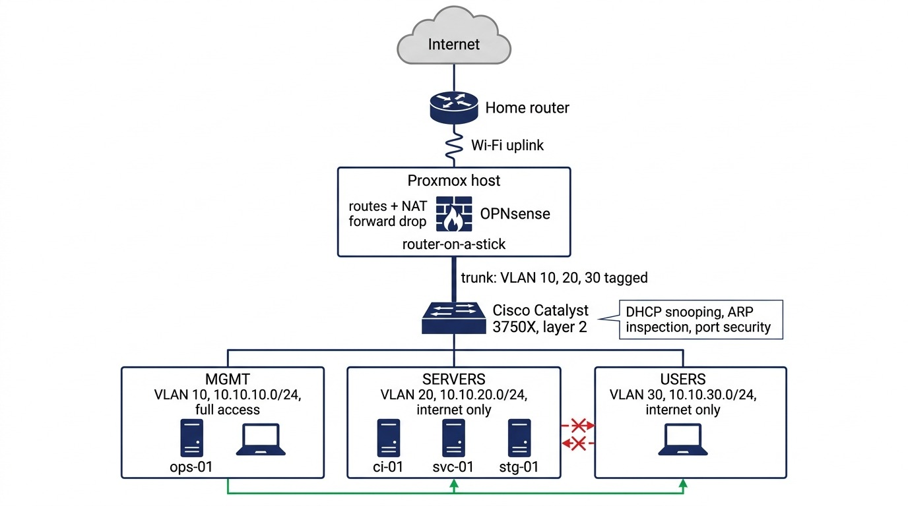

# Enterprise Hybrid Cloud & Network Platform

*A staged home-lab build of enterprise networking, infrastructure as code and pull-based deployment.*

**Goal:** a segmented on-prem network, joined to AWS by a VPN that the home side opens, with deployments applied by an agent that pulls from git.

**Today (2026-10-13):** the on-prem network is built and tested. The AWS side is in progress. This is a learning project, not a production system.



## Status

| # | Stage | State | Evidence | Details |
|---|---|---|---|---|
| 1 | Cisco Catalyst 3750X: VLANs, trunk, layer 2 security | Built, verified | [trunk](docs/evidence/01-switch-trunk.txt), [VLANs](docs/evidence/02-switch-vlans.txt), [layer 2 security](docs/evidence/03-switch-security.txt), [tagged frames](docs/evidence/04-trunk-tagged.txt). Open: VTY ACL | [tasks](docs/SWITCH-CONFIG.md) · [notes](docs/SWITCH-NOTES.md) |
| 2 | Proxmox host: bridges, routed Wi-Fi uplink, NAT | Built, reboot-tested | Uplink, bridges, forwarding and NAT survive a reboot. [Network page](docs/evidence/09-proxmox-network.png) | [tasks](docs/PROXMOX-CONFIG.md) · [notes](docs/PROXMOX-NOTES.md) |
| 3 | OPNsense: routing between zones, DHCP, DNS, rule set | Built, tested (IPv4) | Proof tests V1–V10 passed: [path out](docs/evidence/05-users-path.txt), [blocked](docs/evidence/06-users-blocked.txt), [firewall log](docs/evidence/07-firewall-blocks.png), [rules](docs/evidence/08-firewall-rules-users.png). V10 added after [incident 2](docs/TROUBLESHOOTING-LOG.md) | [tasks](docs/OPNSENSE-CONFIG.md) · [notes](docs/OPNSENSE-NOTES.md) · [run sheet](docs/OPNSENSE-MVP-RUNSHEET.md) |
| 4 | Home VMs from a cloud-init template | Built | `ops-01`, `ci-01`, `svc-01`, `stg-01` running, key-only SSH, zone placement checked | [workbook](docs/blocks/BLOCK-01-TEMPLATE-AND-VMS.md) |
| 5 | AWS VPC and server with Terraform | In progress | — | [workbook](docs/blocks/BLOCK-03-TERRAFORM.md) |
| 6 | Server configuration with Ansible | In progress | — | [workbook](docs/blocks/BLOCK-05-ANSIBLE.md) |
| 7 | WireGuard tunnel, home to AWS | Planned | — | [design](docs/HYBRID-SLICE-DESIGN.md) |
| 8 | CI, pull-based deploy, monitoring | Planned | — | [design](docs/HYBRID-SLICE-DESIGN.md) |

## Skills shown here

Each row links to where the skill can be checked. Rows for Terraform, Ansible, WireGuard and monitoring are added as those stages are built.

| Skill | Where it is shown |
|---|---|
| VLANs, 802.1Q trunking, native VLAN | [evidence 01](docs/evidence/01-switch-trunk.txt), [02](docs/evidence/02-switch-vlans.txt) · [switch notes](docs/SWITCH-NOTES.md) |
| Rapid PVST+, BPDU Guard | [evidence 03](docs/evidence/03-switch-security.txt) |
| Port security, DHCP snooping, Dynamic ARP Inspection | [evidence 03](docs/evidence/03-switch-security.txt) · [switch tasks](docs/SWITCH-CONFIG.md) |
| Inter-VLAN routing, router on a stick | [evidence 04](docs/evidence/04-trunk-tagged.txt), [05](docs/evidence/05-users-path.txt) · V6 in [OPNsense tasks](docs/OPNSENSE-CONFIG.md) |
| Stateful firewall rules, network segmentation | [evidence 06](docs/evidence/06-users-blocked.txt), [07](docs/evidence/07-firewall-blocks.png), [08](docs/evidence/08-firewall-rules-users.png) · [OPNsense notes](docs/OPNSENSE-NOTES.md) |
| DHCP and DNS | [evidence 05](docs/evidence/05-users-path.txt) · [OPNsense tasks](docs/OPNSENSE-CONFIG.md), section O6 |
| Linux forwarding and NAT with nftables | [nftables lesson](docs/LESSON-NFTABLES-NAT.md) · [Proxmox tasks](docs/PROXMOX-CONFIG.md) |
| Proxmox bridges and VLAN-aware bridges | [evidence 09](docs/evidence/09-proxmox-network.png) · [Proxmox networking lesson](docs/LESSON-PROXMOX-NETWORKING.md) |
| Packet capture with tcpdump | [evidence 04](docs/evidence/04-trunk-tagged.txt), [11](docs/evidence/11-mgmt-capture-before-fix.txt) |
| Troubleshooting layer by layer | [troubleshooting log](docs/TROUBLESHOOTING-LOG.md) · [lockout lesson](docs/LESSON-TROUBLESHOOTING.md) |
| VM templates with cloud-init | [block 1 workbook](docs/blocks/BLOCK-01-TEMPLATE-AND-VMS.md) |

## The network today



<details>
<summary>Same diagram as text, with interface names and addresses</summary>

```text
internet
   │
home router 10.0.0.1                      not administered by me
   ┆ Wi-Fi
┌──┴─────────────── Proxmox host (one Ethernet port + Wi-Fi) ────────────────┐
│ wlo1    10.0.0.67 (DHCP)        Wi-Fi uplink                               │
│           ▲ host routes + NATs, forward policy drop                        │
│ vmbr0   192.168.250.1/30        transit link to the firewall, no cable     │
│           │                                                                │
│ OPNsense fw-01    WAN 192.168.250.2/30    gateway .1 in each VLAN          │
│           │                                                                │
│ vmbr1   VLAN-aware bridge       vmbr1.10 = 10.10.10.5/24 (host management) │
│ nic0    Ethernet port, member of vmbr1                                     │
└──┬─────────────────────────────────────────────────────────────────────────┘
   │ one cable, 802.1Q trunk, VLANs 10, 20, 30 tagged
Cisco Catalyst 3750X      layer 2 only, management 10.10.10.2
   ├─ VLAN 10  MGMT      10.10.10.0/24   admin laptop, ops-01
   ├─ VLAN 20  SERVERS   10.10.20.0/24   ci-01, svc-01, stg-01
   └─ VLAN 30  USERS     10.10.30.0/24   DHCP clients
```

</details>

The VLANs separate the zones at layer 2. OPNsense is the only router between them, and its stateful rules are what isolate them:

- **MGMT** has unrestricted outbound access by design, for now. Narrowing it is part of the full rule matrix, which is not done.
- **SERVERS and USERS** may reach DNS, NTP and ping on their own gateway, and the internet. They are blocked from the firewall's own addresses and from RFC 1918 destinations: the other zones, the transit link and the home LAN. Other special-purpose ranges, such as 100.64.0.0/10, are not blocked.
- **WAN** has no user-defined pass rules and no port forwards. No unsolicited inbound connection is permitted; only replies to connections started from inside.
- **The Proxmox host** forwards one flow: traffic from the transit link (192.168.250.0/30) entering `vmbr0` and leaving `wlo1`, plus its replies. Everything else is dropped.

## Planned, not built

- The home lab exposes no service to the internet. The public application will be served from one EC2 instance: Caddy, the app and PostgreSQL on the same host, which is a stated shortcut.
- Home opens a WireGuard tunnel (10.10.99.0/30: OPNsense `.1`, AWS `.2`) outbound to the instance's Elastic IP. No port forward is needed at home; a keepalive holds the NAT mappings. On the tunnel interface, OPNsense blocks and logs anything AWS tries to start.
- Open to the internet on AWS: TCP 80, 443 and UDP 51820. SSH and metrics are reachable only through the tunnel. SSH stays for administration and recovery, through the tunnel from the management zone.
- Git holds the desired state. An agent on the instance pulls it every two minutes, applies it, checks health and returns to the previous version on failure. The repository and images are public, so the agent holds no credentials. Routine deployments need no login.

The flows, firewall changes, where each secret lives and the accepted simplifications with their costs (no database backups yet, one instance, local Terraform state): [design document](docs/HYBRID-SLICE-DESIGN.md), sections 4 to 9.

## The hardest problem at each stage

- **Switch.** The new host was unreachable. It sent untagged frames, the trunk classified them into native VLAN 99, and VLAN 99 is excluded from the trunk's allowed list, so they were dropped. The switch behaved as configured; the host's management traffic needed a VLAN tag.
- **Proxmox.** A network reload over SSH killed the Wi-Fi login and the automatic rollback failed the same way. The previous boot's journal showed a second `wpa_supplicant` colliding with the first. A rollback that uses the same mechanism as the change fails with it. [Step by step](docs/LESSON-TROUBLESHOOTING.md).
- **OPNsense.** After install, LAN and WAN were reversed, and the admin laptop in VLAN 10 could not reach the firewall at all. Interfaces are assigned by MAC address, and the LAN had to be created as a VLAN at the console first.

The rest are in the "What went wrong" table of each notes file. Every real fault, with the checks that found it: [troubleshooting log](docs/TROUBLESHOOTING-LOG.md).

## Known gaps

- The switch runs an old IOS with known CVEs. Its SSH is not reachable from the internet, and the firewall blocks it from the other zones (checked from USERS). The VTY ACL on the switch itself is not applied yet.
- Firewall hardening is outstanding: a dedicated admin account, key-only SSH, and TOTP for GUI logins.
- The uplink is Wi-Fi behind a router I do not administer: no DHCP reservation, and three layers of NAT.
- IPv6 is not configured. The lab is IPv4 only for now.

## Repository

`docs/` holds the design, the roadmap, a task list and a notes file per device, lessons and block workbooks. Index: [`docs/README.md`](docs/README.md). Raw proof: [`docs/evidence/`](docs/evidence/README.md). `terraform/`, `ansible/`, `deploy/` and `monitoring/` will be added as those stages are built.

Kept out on purpose: Terraform state, `*.tfvars`, private keys, `.env` files, the OPNsense `config.xml`, the home public IP address, the Wi-Fi name and key, and the AWS account ID. Hardware MAC addresses are masked.
